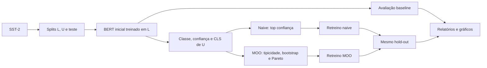

# InstanceSelectionMO

Seleção robusta e multiobjetivo de pseudo-rótulos para classificação de texto com BERT. O projeto compara uma estratégia baseada em confiança absoluta (*naive self-training*) com uma seleção que combina excedente robusto de confiança e não-centralidade no espaço de embeddings.

> Estado: protótipo experimental e reprodutível. Não é uma biblioteca publicada nem um serviço de produção.

## Visão geral

Em cenários com poucos rótulos, um classificador inicial tende a estar mais confiante em exemplos fáceis e próximos das regiões já conhecidas. Selecionar apenas os maiores valores de *softmax* pode, portanto, acrescentar exemplos corretos, mas redundantes. Este projeto procura exemplos que satisfaçam simultaneamente:

1. **qualidade relativa:** confiança maior que a esperada para sua tipicidade;
2. **exploração:** posição menos central dentro da classe prevista;
3. **segurança mínima:** confiança absoluta acima de um piso configurável;
4. **diversidade:** representação espacial da última camada de Pareto quando ela excede o orçamento.

O fluxo usa 100 exemplos rotulados, um pool de 1.500 exemplos tratados como não rotulados e um hold-out de 500 exemplos do SST-2. Todos os tamanhos são configuráveis.

## Resultado registrado

A execução versionada em [`outputs/RESULTS.md`](outputs/RESULTS.md) obteve:

| Estratégia | Acurácia | Macro-F1 |
|---|---:|---:|
| Somente rotulados | 0,6380 | 0,6147 |
| Self-training naive | 0,7320 | 0,7319 |
| Self-training MOO | 0,7140 | 0,7051 |

Esses números são uma única execução, não uma estimativa estatística. Nela, ambos os métodos de self-training superaram o baseline, e o naive superou o MOO; isso não estabelece uma ordenação geral entre estratégias. Veja [limitações](docs/LIMITACOES.md).

## Arquitetura resumida



Detalhes de componentes, dependências e fluxo de memória estão em [Arquitetura](docs/ARQUITETURA.md). A formulação completa, incluindo todas as equações e intuições, está em [Modelagem matemática](docs/MODELAGEM_MATEMATICA.md).

## Instalação rápida

Requisitos: Python 3.10 ou superior; Python 3.12 é a versão validada. MPS, CUDA ou CPU são detectados automaticamente.

```bash
python3.12 -m venv .venv
source .venv/bin/activate
python -m pip install --upgrade pip
python -m pip install -r requirements.txt
```

Na primeira execução, o checkpoint `bert-base-uncased` e o dataset `stanfordnlp/sst2` serão baixados pelo Hugging Face. Instruções por plataforma e solução de problemas: [Instalação](docs/INSTALACAO.md).

## Uso

Execute o experimento completo a partir da raiz:

```bash
python -u -c "import pipeline; pipeline.run_full_pipeline()"
```

O comando treina três modelos sequencialmente e grava diagnósticos em `data/`, métricas em `outputs/` e figuras em `plots/`. Consulte [Uso](docs/USO.md) para o ciclo completo, interpretação dos artefatos e exemplos de uso programático.

## Configuração

Os parâmetros ficam centralizados em [`config.py`](config.py):

| Grupo | Principais padrões |
|---|---|
| Modelo | BERT uncased, sequência 128, lote 4, AdamW a `2e-5`, dropout `0,1` |
| Treino | até 20 épocas, paciência 3, validação interna 20%, semente 42 |
| Dados | 100 rotulados, 1.500 no pool, 500 no hold-out |
| Seleção | `k=15`, piso `0,7`, margem `z=1`, 100 bootstraps, orçamento 100 |

O significado, o intervalo válido e o efeito de cada parâmetro estão em [Configuração](docs/CONFIGURACAO.md).

## Estrutura de pastas

```text
InstanceSelectionMO/
├── config.py                 # dataclasses, caminhos e padrões
├── data_utils.py             # download, splits e Dataset PyTorch
├── modeling.py               # treino, avaliação e embeddings BERT
├── selection.py              # núcleo multiobjetivo
├── plotting.py               # figuras e análise por quartis
├── pipeline.py               # orquestração ponta a ponta
├── requirements.txt          # dependências diretas
├── tests/                    # testes unitários rápidos
├── docs/                     # documentação temática
├── data/                     # diagnósticos versionados da execução
├── outputs/                  # métricas e relatório da execução
└── plots/                    # visualizações versionadas
```

Caches, ambientes virtuais, modelos baixados, checkpoints e arquivos de segredo são ignorados pelo Git. A descrição de cada caminho e política de artefatos está em [Arquitetura](docs/ARQUITETURA.md#estrutura-do-repositório).

## Testes

```bash
python -m unittest discover -s tests -v
python -m compileall -q . -x '(^|/)(\.venv|\.git)/'
```

Os testes cobrem tipicidade, fronteira de Pareto, reprodutibilidade do bootstrap e associação de rótulos por índice global. Escopo e lacunas: [Testes](docs/TESTES.md).

## Documentação

- [Modelagem matemática](docs/MODELAGEM_MATEMATICA.md) — equações, intuição e complexidade.
- [Arquitetura](docs/ARQUITETURA.md) — componentes, dados, fluxos e estrutura.
- [Instalação](docs/INSTALACAO.md) — ambiente e aceleradores.
- [Configuração](docs/CONFIGURACAO.md) — todos os parâmetros e efeitos.
- [Uso](docs/USO.md) — execução, saídas e interpretação.
- [API Python](docs/API.md) — módulos, classes e funções públicas.
- [Decisões técnicas](docs/DECISOES_TECNICAS.md) — escolhas e alternativas.
- [Testes](docs/TESTES.md) — estratégia e comandos.
- [Limitações](docs/LIMITACOES.md) — validade, riscos e trabalho futuro.
- [Segurança](docs/SEGURANCA.md) — segredos, dados e publicação.

## Reprodutibilidade e uso responsável

O pipeline semeia Python, NumPy e PyTorch e reinicia as sementes antes de cada retreino. Ainda pode haver não determinismo em aceleradores e bibliotecas nativas. Para pesquisa, rode várias sementes, reporte média e dispersão, preserve um conjunto de teste externo e não escolha hiperparâmetros pelos resultados deste hold-out.

SST-2 e BERT têm licenças e termos próprios. Antes de uso fora de pesquisa, avalie privacidade dos textos, vieses, calibração, mudança de domínio e custo de erros por classe.
