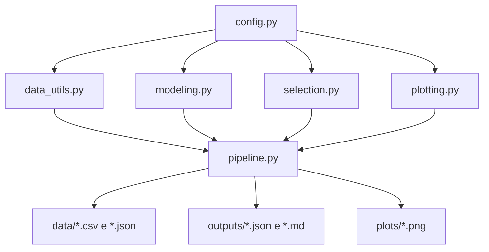
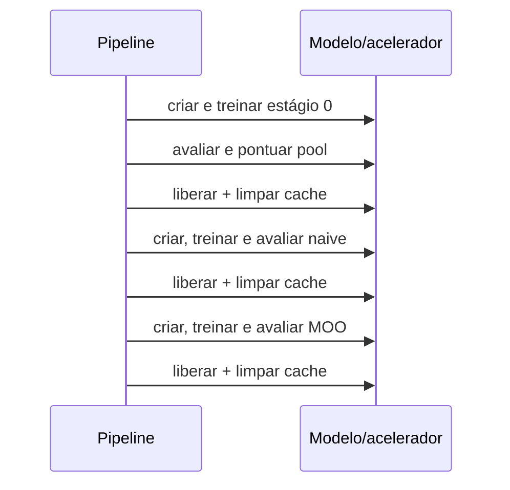

# Arquitetura

## Visão de componentes

O projeto é um pipeline Python em módulos, sem servidor, banco de dados ou API HTTP. `pipeline.py` orquestra componentes com responsabilidades estreitas:



| Componente | Responsabilidade | Dependências principais |
|---|---|---|
| `config.py` | caminhos e dataclasses de configuração | biblioteca padrão |
| `data_utils.py` | SST-2, splits e tokenização sob demanda | datasets, NumPy, PyTorch |
| `modeling.py` | dispositivo, sementes, BERT, treino, avaliação e embeddings | PyTorch, Transformers, scikit-learn |
| `selection.py` | tipicidade, bootstrap isotônico, Pareto, K-Means | NumPy, pandas, scikit-learn |
| `plotting.py` | diagnósticos e projeções 2D | Matplotlib, seaborn, PCA, UMAP |
| `pipeline.py` | sequência experimental e persistência | todos os módulos anteriores |

## Fluxo de dados

1. `build_splits()` baixa e embaralha `stanfordnlp/sst2` com a semente configurada.
2. O split `train` do dataset é fatiado sem sobreposição em `labeled`, `unlabeled` e `test`.
3. Um BERT é treinado em `labeled` e avaliado em `test`.
4. O mesmo modelo pontua `unlabeled`, gerando classe, confiança e embedding `[CLS]`.
5. `selection.py` produz índices MOO e naive sem consultar o rótulo verdadeiro do pool.
6. Dois novos modelos partem novamente do checkpoint base e são treinados com `labeled` mais seus pseudo-rótulos.
7. Os três modelos são avaliados no mesmo hold-out.
8. Os rótulos verdadeiros do pool são usados apenas para diagnósticos offline.

```text
rótulos de L ──► treino inicial e retreinos
textos de U ───► inferência, seleção e pseudo-rótulos
rótulos de U ──► precisão offline depois da seleção
rótulos de T ──► avaliação dos modelos
```

O `test` é um hold-out interno retirado do `train` original do SST-2, não o split oficial de teste do GLUE.

## Ciclo de memória

Somente um modelo deve residir no acelerador por vez:



`free_model()` executa coleta de lixo e limpa cache MPS ou CUDA. Os tensores do pool permanecem em CPU.

## Estrutura do repositório

```text
.
├── README.md
├── requirements.txt
├── config.py
├── data_utils.py
├── modeling.py
├── selection.py
├── plotting.py
├── pipeline.py
├── docs/
│   ├── API.md
│   ├── ARQUITETURA.md
│   ├── CONFIGURACAO.md
│   ├── DECISOES_TECNICAS.md
│   ├── INSTALACAO.md
│   ├── LIMITACOES.md
│   ├── MODELAGEM_MATEMATICA.md
│   ├── SEGURANCA.md
│   ├── TESTES.md
│   └── USO.md
├── tests/
│   ├── test_plotting.py
│   └── test_selection.py
├── data/
│   ├── dataset_report.json
│   ├── precision_by_bucket.csv
│   └── selection_diagnostics.csv
├── outputs/
│   ├── RESULTS.md
│   └── results.json
└── plots/
    └── *.png
```

Os artefatos pequenos da execução de referência são versionados para auditoria. Ambientes, caches, pesos e checkpoints são regeneráveis e ficam no `.gitignore`.

## Interfaces e acoplamento

- `config.py` expõe instâncias globais mutáveis (`MODEL_CFG`, `DATA_CFG`, `SEL_CFG`). É simples para experimentos, mas acopla os módulos ao processo atual.
- As funções trocam objetos Python, arrays NumPy, tensores PyTorch e DataFrames; não existe esquema externo versionado.
- `pipeline.run_full_pipeline()` é o único ponto de entrada ponta a ponta.
- Arquivos são gravados diretamente nos diretórios definidos em `config.py`; não há camada de armazenamento.

## Fronteiras de confiança

O download de modelos e dados é a única dependência de rede durante a execução. O projeto não precisa de tokens para recursos públicos. Se um token do Hugging Face for necessário para outro checkpoint, ele deve permanecer em variável de ambiente ou no mecanismo de autenticação da ferramenta, nunca no repositório.
