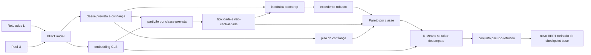

# Modelagem matemática

## 1. Problema

Sejam o conjunto rotulado, o pool tratado como não rotulado e o hold-out:

$$
L=\{(x_i,y_i)\}_{i=1}^{n_L},\qquad
U=\{u_j\}_{j=1}^{n_U},\qquad
T=\{(x_t,y_t)\}_{t=1}^{n_T}.
$$

Um classificador inicial $f_\theta$, treinado somente em $L$, produz *logits* $a(u)\in\mathbb{R}^C$. A distribuição predita, a classe e a confiança são:

$$
p_\theta(y=c\mid u)=\frac{e^{a_c(u)}}{\sum_{j=1}^{C}e^{a_j(u)}},\qquad
\hat y(u)=\arg\max_c p_\theta(y=c\mid u),\qquad
q(u)=\max_c p_\theta(y=c\mid u).
$$

O objetivo é escolher $S\subseteq U$, sujeito a um orçamento $B$, atribuir $\hat y(u)$ aos exemplos escolhidos e formar:

$$
L'=L\cup\{(u,\hat y(u)):u\in S\}.
$$

A hipótese é que maximizar apenas $q$ favorece exemplos fáceis e redundantes. A estratégia MOO preserva dois objetivos sem reduzi-los a uma soma ponderada: qualidade relativa robusta e não-centralidade.

### Mapa das interações

O método é uma cadeia: cada quantidade herda decisões e erros das anteriores.



As interações mais importantes são:

- o modelo inicial define ao mesmo tempo a classe, a confiança e o espaço geométrico;
- a classe prevista define quais pontos podem ser vizinhos entre si;
- a geometria define a tipicidade, que condiciona a confiança esperada;
- o bootstrap transforma instabilidade da curva em penalização de qualidade;
- o piso atua antes do Pareto e pode reduzir o conjunto abaixo do orçamento;
- Pareto decide o compromisso qualidade–exploração; K-Means só desempata a última camada;
- os pseudo-rótulos selecionados alteram dados de treino e validação interna do modelo final.

## 2. Representação no espaço latente

Para cada texto tokenizado, o BERT devolve estados ocultos da última camada. O projeto usa o vetor do token `[CLS]`:

$$
z(u)=h_{[CLS]}^{(\mathrm{última})}(u)\in\mathbb{R}^{768}
$$

para `bert-base-uncased`. Não há *pooling* médio, normalização L2 nem redução de dimensionalidade antes da seleção. PCA e UMAP servem apenas para visualização posterior.

Todos os cálculos seguintes são feitos separadamente em

$$
U_c=\{u\in U:\hat y(u)=c\},
$$

isto é, grupos definidos pela classe **predita**, não pelo rótulo verdadeiro.

## 3. Tipicidade e não-centralidade

Para $u\in U_c$, sejam $N_k(u)$ seus $k$ vizinhos distintos mais próximos sob distância euclidiana:

$$
d(u,v)=\lVert z(u)-z(v)\rVert_2.
$$

O próprio ponto é removido da consulta kNN. Se a classe tiver menos que $k+1$ pontos, usa-se $k_{efetivo}=|U_c|-1$. A distância local média é:

$$
\bar d_k(u)=\frac{1}{k_{efetivo}}\sum_{v\in N_{k_{efetivo}}(u)}d(u,v).
$$

Define-se a tipicidade bruta, com $\varepsilon=10^{-9}$, por:

$$
\tau_{raw}(u)=\frac{1}{\bar d_k(u)+\varepsilon}.
$$

Valores grandes indicam vizinhança densa. Como a escala depende da geometria de cada classe, aplica-se normalização *min-max* dentro de $U_c$:

$$
\tau(u)=
\frac{\tau_{raw}(u)-\min_{v\in U_c}\tau_{raw}(v)}
{\max_{v\in U_c}\tau_{raw}(v)-\min_{v\in U_c}\tau_{raw}(v)+\varepsilon}.
$$

A não-centralidade, usada como objetivo de exploração, é:

$$
\delta(u)=1-\tau(u).
$$

Assim, $\delta\approx1$ representa uma região relativamente periférica dentro da classe prevista; não significa anomalia absoluta nem distância comparável entre classes ou execuções. Para uma classe com um único ponto, a implementação define $\tau=1$ e $\delta=0$.

## 4. Confiança esperada condicionada à tipicidade

A confiança absoluta costuma variar com a centralidade. Para estimar o nível esperado em cada região, ajusta-se uma regressão isotônica crescente por classe:

$$
\hat q_c=\arg\min_{g}\sum_{u\in U_c}\left(q(u)-g(\tau(u))\right)^2
\quad\text{sujeito a}\quad
\tau_a\leq\tau_b\Rightarrow g(\tau_a)\leq g(\tau_b).
$$

O `scikit-learn` resolve o problema por uma variante do algoritmo PAVA (*Pool Adjacent Violators Algorithm*) e usa `out_of_bounds="clip"`. A monotonicidade codifica a expectativa de que regiões mais típicas não tenham confiança média menor. Ela é uma hipótese de modelagem, não uma propriedade garantida dos dados.

O excedente de confiança é o resíduo:

$$
r(u)=q(u)-\hat q_c(\tau(u)).
$$

Um $r>0$ diz que o modelo está mais confiante nesse ponto do que em pontos de tipicidade semelhante. Isso não implica que a predição esteja correta.

## 5. Incerteza por bootstrap

Para reduzir a preferência por resíduos instáveis, o conjunto $U_c$ é reamostrado com reposição $M$ vezes. Para cada réplica $b$, ajusta-se $\hat q_c^{(b)}$ e prediz-se nos valores originais de $\tau$. A implementação usa:

$$
\bar q_c(\tau)=\frac{1}{M}\sum_{b=1}^{M}\hat q_c^{(b)}(\tau)
$$

e o desvio-padrão populacional das réplicas:

$$
w_c(\tau)=
\sqrt{\frac{1}{M}\sum_{b=1}^{M}
\left(\hat q_c^{(b)}(\tau)-\bar q_c(\tau)\right)^2}.
$$

No código, `expected_conf` é $\bar q_c$, portanto o resíduo efetivo é $r=q-\bar q_c$. O objetivo conservador é:

$$
r_{lower}(u)=r(u)-z\,w_c(\tau(u)).
$$

`z_margin` controla a penalização, mas esta expressão não deve ser chamada automaticamente de limite de confiança de nível conhecido: o desvio-padrão bootstrap não é convertido em quantil nem há correção de cobertura. Com $z=0$, ignora-se a incerteza; valores maiores favorecem regiões com estimativa mais estável.

## 6. Piso de confiança

Antes do Pareto, o candidato MOO deve obedecer:

$$
q(u)\geq\tau_c.
$$

O piso impede que um exemplo muito incerto vença apenas por superar uma expectativa local ainda menor. O baseline naive não aplica esse piso: ele escolhe os maiores valores de $q$ disponíveis em cada classe prevista.

## 7. Dominância e camadas de Pareto

Cada candidato válido é representado pelo vetor:

$$
F(u)=\big(r_{lower}(u),\delta(u)\big),
$$

e ambos os componentes são maximizados. Um ponto $a$ domina $b$ quando:

$$
r_{lower}(a)\geq r_{lower}(b),\qquad
\delta(a)\geq\delta(b),
$$

com ao menos uma desigualdade estrita. A primeira fronteira é:

$$
P_1=\{u:\nexists v\text{ que domine }u\}.
$$

Se $P_1$ não preenche o orçamento, ela é removida e o mesmo procedimento gera $P_2,P_3,\ldots$. Isso é *non-dominated sorting*, mas não NSGA-II: não há população evolutiva, cruzamento, mutação ou *crowding distance*.

## 8. Orçamento e dispersão

Com $C$ classes, o orçamento por classe é:

$$
b_c=\left\lfloor\frac{B}{C}\right\rfloor.
$$

O resto de $B/C$ não é redistribuído e vagas de uma classe sem candidatos também não migram para outra. Logo, $|S|$ pode ser menor que $B$.

Fronteiras completas são adicionadas em ordem. Se a próxima fronteira tiver mais pontos que as vagas $m$, roda-se K-Means com $m$ clusters sobre os embeddings originais dessa fronteira. Para cada centróide $\mu_j$, escolhe-se o membro:

$$
u_j^*=\arg\min_{u:\,cluster(u)=j}\lVert z(u)-\mu_j\rVert_2.
$$

Esse passo é uma heurística de dispersão. Ele não resolve formalmente *facility location* nem garante a cobertura global ótima.

## 9. Baseline naive

Para cada classe prevista, o baseline ordena por confiança e seleciona os primeiros $b_c$:

$$
S_c^{naive}=\operatorname{TopK}_{u\in U_c}\ q(u).
$$

O balanceamento por classe é mantido para tornar os tamanhos comparáveis. Não há tipicidade, bootstrap, Pareto, piso ou K-Means.

## 10. Treinamento e métricas

Cada modelo minimiza entropia cruzada:

$$
\mathcal L(\theta)=-\frac{1}{n}\sum_{i=1}^{n}\log p_\theta(y_i\mid x_i)
$$

com AdamW. Vinte por cento do conjunto recebido por `train()` forma uma validação interna determinística; o melhor estado pela perda de validação é restaurado. O hold-out $T$ só é usado por `evaluate()`.

A acurácia é

$$
\operatorname{Acc}=\frac{1}{n_T}\sum_t\mathbf 1[\hat y_t=y_t],
$$

e o F1 da classe $c$ é

$$
F1_c=\frac{2P_cR_c}{P_c+R_c},\qquad
P_c=\frac{TP_c}{TP_c+FP_c},\quad
R_c=\frac{TP_c}{TP_c+FN_c}.
$$

O Macro-F1 é $C^{-1}\sum_cF1_c$, dando o mesmo peso a cada classe.

## 11. Custo computacional

Se uma classe tiver $n_c$ pontos e embeddings de dimensão $d$:

- vizinhança kNN em alta dimensão pode aproximar-se de $O(n_c^2d)$ em busca exata;
- cada ajuste isotônico requer ordenação e ajuste linear, aproximadamente $O(n_c\log n_c)$, repetido $M$ vezes;
- a função de fronteira compara pares, $O(n_c^2)$ por camada; repetir muitas camadas pode elevar bastante o custo;
- K-Means depende de pontos, clusters, dimensão, iterações e inicializações;
- treino e inferência do BERT dominam tempo e memória no tamanho de referência.

Esses custos tornam a implementação adequada a experimentos pequenos e médios, mas não a pools massivos sem indexação aproximada, Pareto mais eficiente e processamento incremental.

## 12. Algoritmo completo

Para cada execução, o procedimento efetivo é:

```text
1. Fixar sementes de Python, NumPy e PyTorch.
2. Embaralhar o SST-2 e separar L, U e T sem sobreposição.
3. Treinar f0 em L, usando uma validação interna retirada de L.
4. Para cada u em U, extrair classe prevista, confiança e embedding CLS.
5. Para cada classe prevista c:
   a. formar U_c;
   b. calcular tau e delta por kNN;
   c. ajustar M curvas isotônicas em amostras bootstrap;
   d. calcular expected_conf, uncertainty_w, r e r_lower;
   e. remover candidatos com q < tau_c;
   f. extrair camadas Pareto até preencher b_c;
   g. se a última camada não couber, selecionar representantes por K-Means;
   h. selecionar também o baseline top-confidence.
6. Formar L'_naive e L'_MOO com as classes previstas por f0.
7. Reiniciar a semente e treinar cada modelo final a partir do checkpoint BERT base.
8. Avaliar f0, f_naive e f_MOO no mesmo hold-out T.
9. Somente depois da seleção, comparar pseudo-rótulos com os rótulos reais de U.
```

### Invariantes de isolamento

Durante a seleção, devem valer:

$$
y_T \not\rightarrow \text{treino, seleção ou early stopping},
$$

$$
y_U \not\rightarrow \hat y, q, z, \tau, r_{lower}, P_c \text{ ou K-Means}.
$$

Os rótulos verdadeiros de $U$ entram apenas nos relatórios de precisão offline. O campo `global_idx` preserva a ligação entre uma linha diagnóstica e sua posição original no pool; isso é essencial porque o DataFrame final é concatenado por classe prevista.

## 13. Exemplo numérico do compromisso multiobjetivo

Considere quatro candidatos da mesma classe, com `tau_c = 0.70` e `z_margin = 1`. Depois do bootstrap:

| Ponto | $q$ | $\tau$ | $\delta=1-\tau$ | $\bar q_c(\tau)$ | $w_c(\tau)$ | $r_{lower}=q-\bar q-zw$ |
|---|---:|---:|---:|---:|---:|---:|
| A | 0,94 | 0,90 | 0,10 | 0,92 | 0,01 | 0,01 |
| B | 0,80 | 0,20 | 0,80 | 0,72 | 0,04 | 0,04 |
| C | 0,73 | 0,10 | 0,90 | 0,70 | 0,08 | -0,05 |
| D | 0,65 | 0,15 | 0,85 | 0,69 | 0,03 | -0,07 |

O ponto D é descartado pelo piso, embora seja periférico. B domina A porque tem simultaneamente maior excedente robusto e maior não-centralidade. B não domina C: B tem melhor qualidade relativa, mas C explora mais a periferia. Assim, B e C podem coexistir na primeira fronteira.

O exemplo ilustra quatro fatos:

1. confiança absoluta alta não garante permanência no Pareto;
2. um ponto periférico não é automaticamente bom;
3. a incerteza pode transformar excedente bruto positivo em `r_lower` negativo;
4. Pareto preserva compromissos que uma ordenação unidimensional eliminaria.

Se apenas uma vaga restar para a fronteira contendo B e C, K-Means usa os embeddings, não os valores da tabela, para decidir qual região representar.

## 14. Interações entre parâmetros

Os parâmetros não agem isoladamente.

### `k_knn` × tamanho da classe prevista

O número efetivo é:

$$
k_{efetivo}=\min(k, |U_c|-1).
$$

Em uma classe grande, elevar $k$ suaviza variações locais e aproxima tipicidade de uma densidade regional. Em uma classe pequena, o limite acima faz muitos pontos compartilharem quase a mesma vizinhança. Isso reduz a resolução de $\tau$ e pode criar mais empates na regressão isotônica.

### `k_knn` × geometria do embedding

O kNN usa distância euclidiana diretamente em `[CLS]`. Mudanças em `model_name`, `max_seq_length`, treino ou tokenização alteram $z$ e, portanto, todos os vizinhos. Não se deve comparar valores de $\tau$ entre modelos como se fossem medidos na mesma escala.

### normalização min-max × pontos extremos

Como os extremos definem 0 e 1, um único ponto muito isolado pode comprimir os demais valores de tipicidade. A regressão isotônica recebe essa escala comprimida, embora a ordem dos pontos seja preservada. Uma normalização robusta ou baseada em postos teria outra sensibilidade.

### `tau_c` × orçamento

Seja o conjunto elegível:

$$
V_c=\{u\in U_c:q(u)\geq\tau_c\}.
$$

O máximo selecionável pelo MOO na classe é:

$$
|S_c^{MOO}|\leq\min(b_c,|V_c|).
$$

Logo, aumentar `tau_c` pode melhorar a precisão, mas também deixar o orçamento incompleto e reduzir diversidade. O baseline naive não usa $V_c$, o que cria uma diferença experimental além do critério multiobjetivo.

### `n_bootstraps` × `z_margin`

`n_bootstraps` controla a estabilidade numérica da estimativa de $w$; `z_margin` controla quanto essa estimativa influencia a seleção. Poucas réplicas com $z$ alto podem produzir penalizações voláteis. Muitas réplicas com $z=0$ calculam uma incerteza que não afeta o objetivo.

Em termos de sensibilidade:

$$
\frac{\partial r_{lower}}{\partial z}=-w_c(\tau).
$$

Portanto, aumentar $z$ penaliza mais os pontos justamente onde o bootstrap é mais disperso.

### orçamento × número de classes

Com divisão uniforme,

$$
|S|\leq C\left\lfloor\frac{B}{C}\right\rfloor\leq B.
$$

Se $B$ não for divisível por $C$, o resto é perdido. Se uma classe não preencher $b_c$, suas vagas também são perdidas. Ao mesmo tempo, balancear por classe prevista impede que a classe majoritária domine o conjunto.

### orçamento × camadas Pareto × K-Means

Orçamentos pequenos tendem a terminar na primeira fronteira e acionam K-Means com frequência. Orçamentos maiores incorporam fronteiras sucessivamente dominadas. Portanto, aumentar $B$ muda não só a quantidade, mas o nível de compromisso aceito.

### semente × comparação entre estratégias

A semente afeta:

- embaralhamento do SST-2;
- inicialização da cabeça classificadora;
- divisão treino–validação;
- ordem dos lotes;
- amostras bootstrap;
- inicialização do K-Means;
- projeção UMAP.

Os retreinos naive e MOO reiniciam a mesma semente. Isso melhora comparabilidade, mas não torna os datasets iguais: os 100 pseudo-rótulos e seus textos diferem.

### hiperparâmetros de treino × seletor

`learning_rate`, `dropout_prob`, `max_epochs` e early stopping não afetam apenas o classificador final. Eles moldam o modelo inicial, de onde vêm $q$, $\hat y$ e $z$. Uma mudança de treino pode, portanto, alterar simultaneamente os dois eixos do Pareto e a partição por classe.

## 15. Interação entre seleção e retreino

Para uma estratégia $m\in\{naive,MOO\}$, o conjunto aumentado é:

$$
L'_m=L\cup\{(u,\hat y_0(u)):u\in S_m\},
$$

onde $\hat y_0$ é a predição do modelo inicial. O modelo final não recebe pesos de $f_0$; ele parte novamente de `bert-base-uncased`. Assim, a informação transferida do estágio 0 é o conjunto de exemplos e pseudo-rótulos, não os parâmetros ajustados.

Com os padrões atuais, cada conjunto aumentado contém 200 itens. `validation_fraction = 0.2` separa aproximadamente 40 itens para validação interna e 160 para atualização de gradiente. Como o split é feito sobre $L'_m$, a validação interna pode conter pseudo-rótulos. Ela mede consistência com rótulos mistos, não desempenho exclusivamente contra rótulos humanos.

Esse detalhe cria uma interação importante: pseudo-rótulos ruidosos podem afetar tanto o gradiente quanto o instante de early stopping. Uma alternativa seria manter uma validação fixa formada apenas por exemplos humanos, mas isso reduziria ainda mais o conjunto inicial disponível para treino.

## 16. Relação entre precisão dos pseudo-rótulos e desempenho final

A precisão offline da estratégia $m$ é:

$$
\operatorname{PrecPseudo}_m=
\frac{1}{|S_m|}\sum_{u\in S_m}
\mathbf{1}[\hat y_0(u)=y(u)].
$$

Ela não é a mesma coisa que acurácia do modelo final. Um conjunto pode ter precisão alta e pouca informação nova por ser redundante. Outro pode conter mais erros, mas cobrir regiões que melhoram a fronteira de decisão. Em símbolos, não existe garantia geral de que:

$$
\operatorname{PrecPseudo}_A>
\operatorname{PrecPseudo}_B
\quad\Longrightarrow\quad
\operatorname{Acc}(f_A;T)>
\operatorname{Acc}(f_B;T).
$$

Na execução versionada, naive apresentou maior precisão de pseudo-rótulos e maior desempenho final que MOO. Isso é uma observação de uma semente, não prova de uma relação universal.

## 17. Diagnósticos e interpretação conjunta

Os campos de `selection_diagnostics.csv` formam a seguinte cadeia:

| Campo | Depende diretamente de | Pergunta respondida |
|---|---|---|
| `class` | logits | Qual classe o modelo inicial escolheu? |
| `confidence` | softmax | Quão concentrada é a predição? |
| `typicality` | classe + embedding + kNN | Quão densa é a vizinhança relativa? |
| `delta` | tipicidade | Quão periférico é o ponto? |
| `expected_conf` | tipicidade + confiança + bootstrap | Qual confiança é usual nessa região? |
| `uncertainty_w` | variação entre bootstraps | Quão instável é essa expectativa? |
| `r_lower` | confiança, expectativa, incerteza e $z$ | Quanto excedente conservador resta? |
| `selected_moo` | piso, Pareto, orçamento e K-Means | O ponto entrou no conjunto MOO? |
| `selected_naive` | confiança e orçamento | O ponto entrou no baseline? |

Nenhum gráfico isolado valida a hipótese. A leitura recomendada combina:

1. confiança versus tipicidade, para inspecionar a hipótese monotônica;
2. plano $(\delta,r_{lower})$, para enxergar compromissos Pareto;
3. PCA/UMAP, para observar redundância espacial com a ressalva de projeção;
4. precisão por quartil, para localizar ruído dos pseudo-rótulos;
5. acurácia e Macro-F1 finais, para medir utilidade no hold-out.

## 18. Correspondência entre símbolos e implementação

| Símbolo | Código |
|---|---|
| $L,U,T$ | `labeled`, `unlabeled`, `test` em `pipeline.py` |
| $f_0$ | `model0` |
| $\hat y(u)$ | `pool_scores["pred_class"]` |
| $q(u)$ | `pool_scores["confidence"]` |
| $z(u)$ | `pool_scores["embeddings"]` |
| $\tau(u)$ | coluna `typicality` |
| $\delta(u)$ | coluna `delta` |
| $\bar q_c$ | coluna `expected_conf` |
| $w_c$ | coluna `uncertainty_w` |
| $r_{lower}$ | coluna `r_lower` |
| $B$ | `SEL_CFG.target_selection_size` |
| $b_c$ | `target_selection_size // num_classes` |
| $S_{MOO}$ | `moo_idx` |
| $S_{naive}$ | `naive_idx` |

Há uma colisão de notação que merece atenção: $\tau(u)$ é tipicidade, enquanto `tau_c` é o piso absoluto de confiança. Eles não têm a mesma unidade conceitual.

## 19. O que o método otimiza — e o que não otimiza

O seletor maximiza uma ordem parcial sobre dois escores calculados pelo próprio modelo. Ele não otimiza diretamente:

- acurácia futura no hold-out;
- calibração probabilística;
- precisão verdadeira dos pseudo-rótulos;
- distância mínima global entre todos os selecionados;
- uma função exata de cobertura ou *facility location*;
- justiça, robustez fora de domínio ou custo por classe.

Por isso, MOO deve ser entendido como uma heurística experimental de seleção com objetivos interpretáveis. A validade externa exige múltiplas sementes, baselines equivalentes, ablações de cada componente e avaliação em datasets adicionais.
